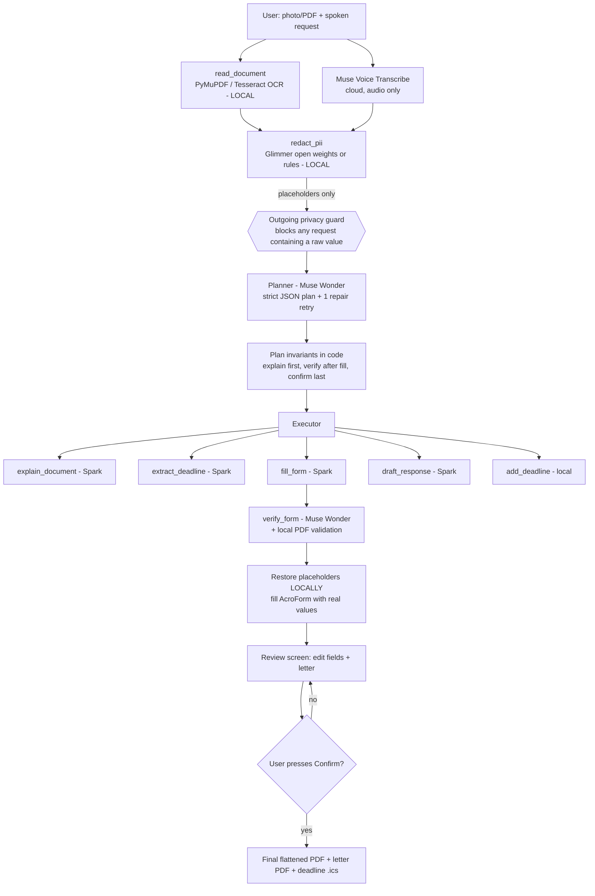

# PaperPilot

**Photograph a difficult official document, say what you need in your own language, and PaperPilot explains it, plans the next steps, fills the form, drafts the reply and tracks the deadline. Your personal data is redacted on your device before any cloud AI sees it.**

> ⚠️ **Not legal advice.** PaperPilot explains, plans, drafts and fills. It never makes decisions for you, never signs for you and never submits anything. You review and confirm everything.

Built for the Meta AI Developer Hackathon (Indie Developer track, theme "Build for Your World"). All sample data is fictional.

---

## The problem

Millions of people get official paperwork they can't easily read: utility notices, benefit letters, bank and school forms, rental documents. The paperwork is written in legal or bureaucratic English, has hidden deadlines and comes with forms that are easy to fill in wrong. Missing the deadline costs real money: late fees, collections, lost benefits. The people hit hardest are often reading in their second or third language.

## What PaperPilot does

1. **Upload** a photo or PDF, or pick a sample.
2. **Speak** your request in your own language (Muse Voice Transcribe, 25 languages).
3. **Protect.** OCR and PII redaction run locally. Names, addresses, account numbers, phone numbers, emails, dates of birth and IDs become `[NAME_1]`, `[ACCOUNT_1]` and so on.
4. **Plan.** Muse Wonder writes a JSON plan of tool calls, validated with Pydantic. Safety rules are enforced in code.
5. **Act.** Muse Spark explains the document in *your* language, extracts deadlines, fills the form and drafts the reply letter in the *recipient's* language.
6. **Verify.** Muse Wonder checks every filled value against the source and flags low-confidence fields. A local check confirms the PDF stores exactly what was intended.
7. **Review and confirm.** You see the original and filled pages side by side and can edit any field. Nothing is final until you press **Confirm**.
8. **Track.** The deadline is saved as a reminder and can be exported as `.ics`.

## Architecture



Every model call goes through `backend/app/services/model_router.py`. The router chooses the model for each task, enforces the budget cap, retries with exponential backoff, logs tokens and cost, replays the demo cache, and runs the privacy guard on the exact serialized payload before anything is sent.

### Agent timeline (what the user sees)

| Step | Where | Model |
|---|---|---|
| Reading the document | Local | PyMuPDF text layer / Tesseract OCR |
| Protecting personal information | Local | Muse Glimmer (if running locally) or rules fallback |
| Understanding your request | Local | Script + stopword language ID |
| Planning next steps | Cloud | `muse-wonder-1.0` |
| Explaining in plain language | Cloud | `muse-spark-1.3` |
| Finding important dates | Cloud | `muse-spark-1.3` |
| Filling the form | Cloud | `muse-spark-1.3` |
| Drafting a response letter | Cloud | `muse-spark-1.3` |
| Verifying the filled form | Cloud | `muse-wonder-1.0` |
| Waiting for your confirmation | Local | — |

The planner chooses the steps. For the utility dispute it plans a reply letter; for the benefit application it does not, because the application itself is the response.

## Meta AI models

Full verified table with IDs, endpoints, prices and limits: **[docs/META_MODELS.md](docs/META_MODELS.md)**.

| Model | Role | Why |
|---|---|---|
| `muse-wonder-1.0` | Planner, verifier | The two judgment calls: which tools to run, and whether each filled value is supported by the source |
| `muse-spark-1.3` | Explain, deadlines, fill, draft | Fast and cheap; about two thirds of the calls |
| `muse-voice-transcribe-1.0` | Speech to text | Multilingual voice input (real mode) |
| Muse Glimmer (open weights, local) | PII detection | Sees raw text only because it runs on the user's machine. Optional; the rules fallback is clearly labelled |

**Not used:** SAM 3.1 (a stretch goal; the sample forms are AcroForms) and Muse Image (not needed).

## Privacy design

- **Local first.** Images are never sent to a cloud model. OCR (Tesseract) and redaction run on the device.
- **Stable placeholders.** The same value always maps to the same placeholder, so `[NAME_1]` in the letter, the form and the explanation is the same person. "Ms. Okafor" and "Amara Okafor" share one placeholder.
- **Local vault.** The placeholder → value map lives only in the server process memory and is never logged. Values are restored only when writing *your* PDF and letter.
- **Defense in depth.** The router scans every outgoing payload for each raw value in the task's vault. If any is found, the request is **blocked, not sent**, and the block is logged with counts only.
- **Proven by tests.** `backend/tests/test_privacy_no_leak.py` runs the whole agent on both samples, with the user also *saying* their name, phone and email. It intercepts every request at the transport layer and asserts that no raw value appears in any of them.
- **Visible.** The Privacy Center shows what was protected, the exact redacted text the AI received, every cloud request, and "0 raw personal values sent to cloud", computed from the audit log rather than hardcoded.
- **Honest labels.** The UI shows whether Glimmer or the rules fallback actually ran.
- **Never AI-filled:** signatures and declarations ("I declare the information is true") are left for the user.

## Run it

Requires Python 3.11+, Node 20+, and optionally `tesseract` for photo OCR.

```bash
git clone https://github.com/Jaswanth7373/metahack.git paperpilot && cd paperpilot
scripts/demo.sh            # installs, resets data, builds samples + demo cache + UI, runs tests, starts the server
open http://127.0.0.1:8010 # Windows: scripts\demo.ps1
```

Development, with hot reload: `make dev-backend` and `make dev-frontend` (UI on :5173, API on :8010).

### Demo mode vs real mode

| | Demo mode (`DEMO_MODE=true`, or no API key) | Real mode (`MODEL_API_KEY=...`, `DEMO_MODE=false`) |
|---|---|---|
| Code path | Same router, agent, tools, privacy guard and PDF filler | Same |
| Model responses | Replayed from `backend/demo_cache/`, marked `replayed` in the UI | Live Meta Model API |
| Spend | $0 (the cost shown is what the call would cost) | Counted against `BUDGET_CAP_USD` |
| Voice | Not available (type instead) | Muse Voice Transcribe |

The cached responses currently in `backend/demo_cache/scenario/` are **hand-written fixtures**, each labelled with a `"source"` field. They were written against the redacted sample text because no API key was available while building. To replace them with real recordings:

```bash
DEMO_MODE=false RECORD_DEMO_CACHE=true scripts/demo.sh   # then run both samples once in the UI
```

### Environment variables

See [.env.example](.env.example). The main ones are `MODEL_API_KEY`, `BUDGET_CAP_USD` (default 100, a hard cap checked *before* each call against a worst-case estimate), `TASK_COST_CAP_USD` (0.50), `MAX_AGENT_STEPS` (10), `DEMO_MODE`, `GLIMMER_MODE=rules|local`.

### Tests

```bash
cd backend && ../.venv/bin/python -m pytest -q     # 35 tests
```

| Area | Covered |
|---|---|
| Router | model routing, retries with backoff, giving up, budget cap blocks before sending, record → replay, cache miss, voice billing |
| Privacy | every PII type, stable placeholders, restore, leak counter, honest Glimmer fallback |
| **No-leak** | full agent on both samples with PII in the spoken request; guard blocks a leaky payload; audit log shows 0 |
| Agent | plan invariants, invalid plan rejected, one repair retry, graceful failure, cost cap, signature/declaration never AI-filled |
| PDF | field extraction, AcroForm fill + validation, flat overlay at coordinates, flattened final copy, letter |
| API | full demo flow (Hindi and Spanish), SSE events, privacy endpoint, edit, confirm gate, deadlines + `.ics`, upload validation |

## Cost per task

From the router's pricing table (official prices, Standard mode). For the utility dispute the token counts are the demo fixtures' estimates (in ≈ 15.3k, out ≈ 2.6k):

| Call | Model | Est. cost |
|---|---|---|
| Plan | Wonder | $0.019 |
| Explain | Spark | $0.006 |
| Deadlines | Spark | $0.003 |
| Fill | Spark | $0.006 |
| Draft letter | Spark | $0.004 |
| Verify | Wonder | $0.023 |
| **Total** | | **≈ $0.06 per document** |

With $100 of the $150 credit capped, that is roughly 1,600 documents. Measure real costs with an API key and record them in [DEVLOG.md](DEVLOG.md).

## Security

`.env` is git-ignored and keys stay on the server, never in the frontend. Uploads accept only PDF, PNG and JPG up to 10 MB, with sanitized filenames. Personal data is never logged: logs carry event names and counts (`PII_REDACTED count=6`). Error messages are user-friendly, with no stack traces. Model API error bodies are not echoed, because they could contain the prompt. Local data lives in git-ignored `backend/data/`.

## Limitations

- The demo cache is hand-written until it is re-recorded with a real API key (see above). Real-mode calls are implemented against the documented API but **have not yet been run with a live key**.
- Voice needs real mode. The browser records, then encodes 16 kHz mono WAV as the transcribe endpoint requires.
- The Muse Glimmer backend is implemented but untested on GPU hardware here. The demo runs the rules fallback and says so.
- The rules engine is tuned for English-language documents with labelled fields. Unlabelled names in free text need Glimmer.
- Flat (non-AcroForm) forms need a coordinate template. Photos still get the explanation, deadlines and letter.
- SAM 3.1 form-region detection was not built.
- The redaction vault and document context live in memory, so restarting the server ends any open review session. Task records, including your filled values, are stored locally in the git-ignored `backend/data/` SQLite database.

## Future work

SAM 3.1 to detect fields on photographed flat forms; Glimmer as the default detector on capable devices; replies read aloud; more document templates (rent, school, tax).

## Hackathon alignment

- **Impact:** paperwork in a second language is an everyday barrier for a lot of people.
- **Meta tooling:** four Meta models, each with a specific job (planner/verifier, workhorse, voice, local open-weight privacy), plus structured output and per-model routing.
- **Agentic:** plan → tool execution → verification → human-in-the-loop pause, with safety enforced in code.
- **Technical depth:** budget-capped router, PII guard on outgoing payloads, demo cache on the same code path, AcroForm automation, 35 tests.
